# AI 8-Puzzle Visualizer

Interactive web app that solves the 8-Puzzle with state-space search and visualizes the search step by step.

## Student Details

- Name: Navya Modgal | Reg No: 24BCB0063 | Course: Artificial Intelligence
- Assigned algorithm: **A\* Search** (other syllabus specified algorithms included for the comparison page)

## Technologies Used

HTML5, CSS3, JavaScript (ES6), Bootstrap 5 (CDN).

## Search Algorithms Implemented

A* (assigned), plus BFS, DFS, DLS, IDDLS, GBFS.

## Heuristics Used

- Misplaced Tiles
- Manhattan Distance (admissible and consistent)

## Features

Manual/random puzzle input (random is always solvable), animated blank-tile movement, live frontier/explored/g/h/f display, successor states, solution path, summary stats, comparison table, algorithm info page, Run/Pause/Resume/Prev/Next/Reset/Speed controls.

## Screenshots

### Home Page
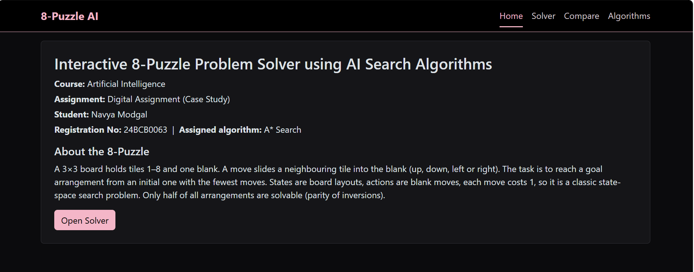

### DLS Search Process
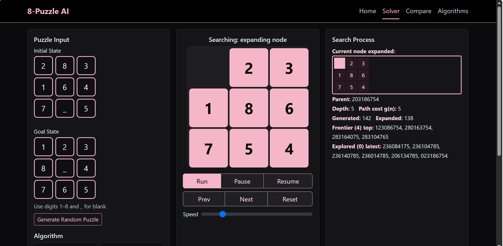

### Initial State and Expanding the Root
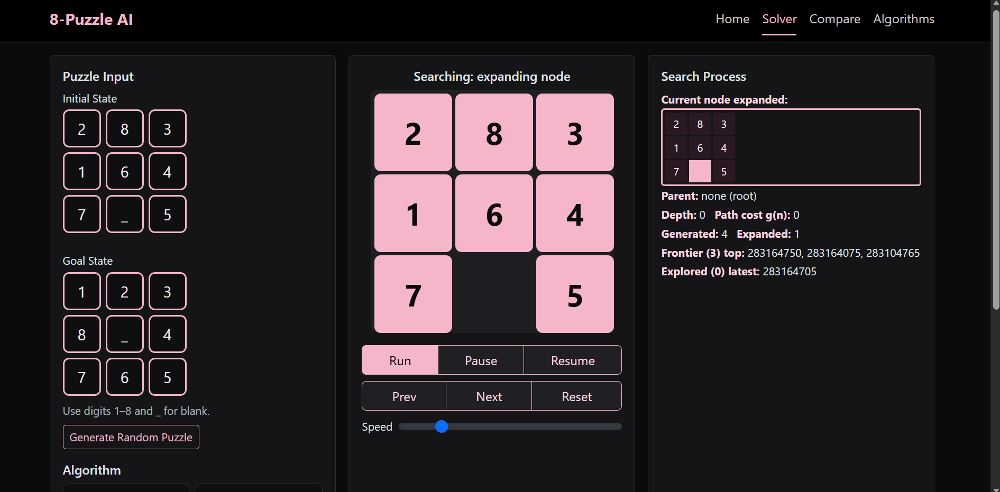

### DLS Depth Limit and Successor States
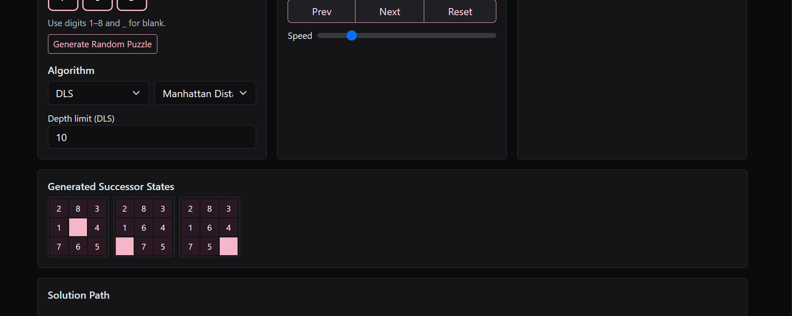

### Solution Path Animation
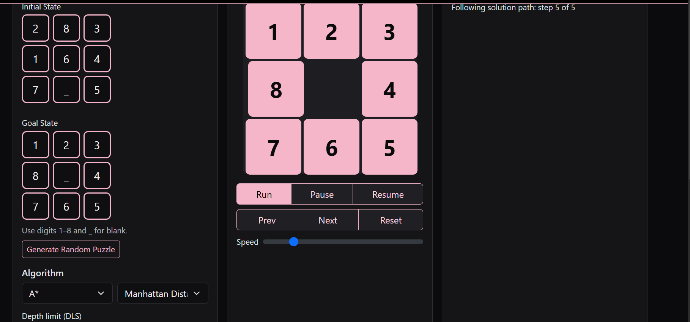

### A* Search Process (h, g, f values)
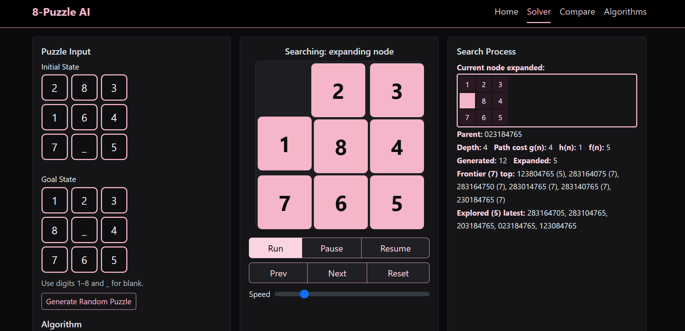

### A* Solution Path and Summary
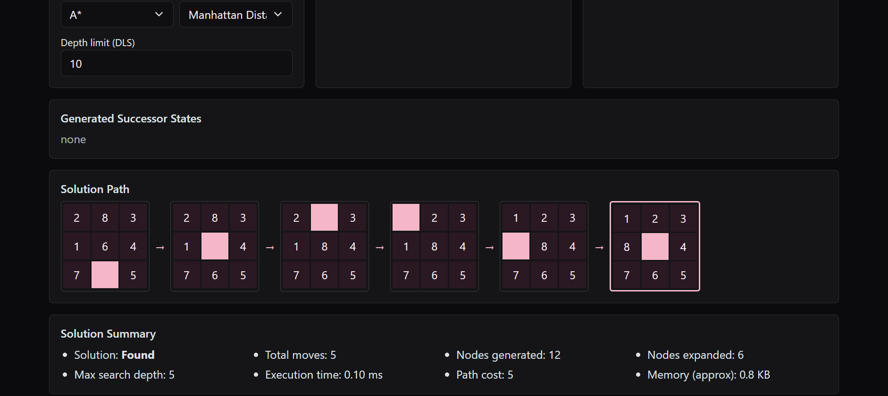

### Algorithm Comparison
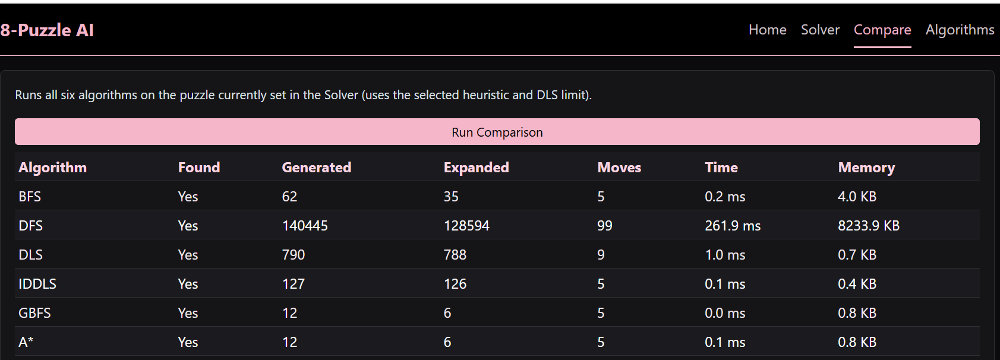

### Algorithm Information: A* and GBFS
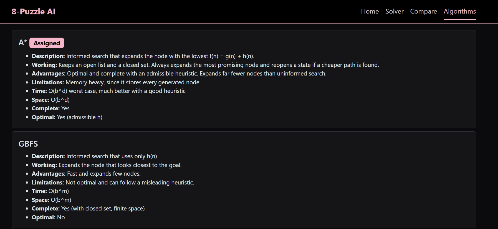

### Algorithm Information: BFS and DFS
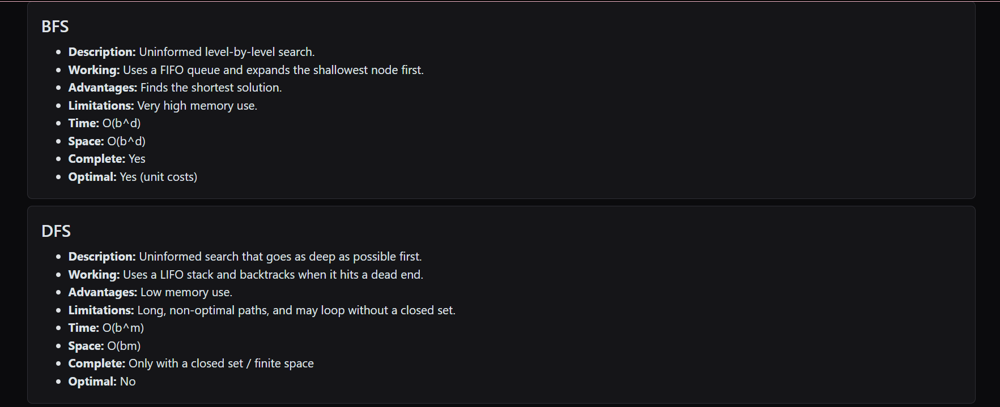

### Algorithm Information: DLS and IDDLS
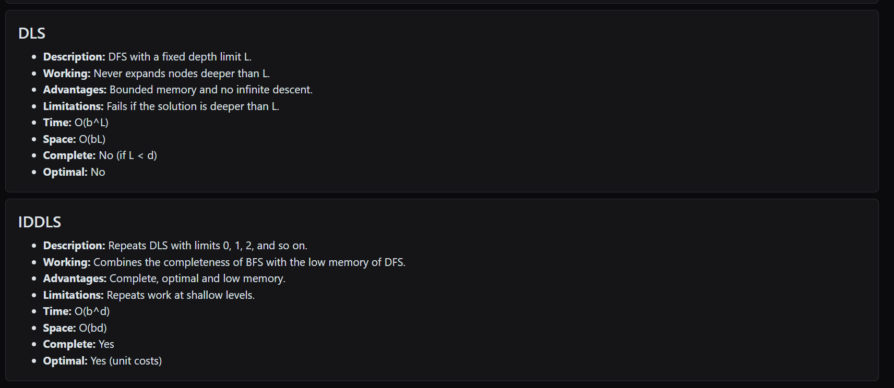

## GitHub Pages URL

 https://github.com/navyamodgal-maker/AI-8Puzzle-Visualizer

## How to Run

Open `index.html` in a browser, or enable GitHub Pages (Settings → Pages → main branch, root).

## References 

- Russell & Norvig, _Artificial Intelligence: A Modern Approach_
- Bootstrap 5 documentation

## AI Chatbots used
-Claude
-Chatgpt

